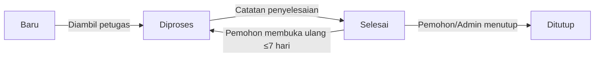

# Algoritma tiket

`php benchmark.php` menghasilkan CSV waktu dan memori untuk n = 100, 1.000, 10.000. `algorithms.php` menjelaskan invarian dan varian pada loop. Angka memori `memory_get_usage(true)` adalah perubahan alokasi blok PHP dan dapat bernilai nol untuk input kecil; analisis Big-O tetap menjadi acuan penggunaan memori.

Alur status:

Pseudocode pengambilan tiket: mulai transaksi; perbarui baris hanya jika status Baru dan belum ditugaskan; jika jumlah baris berubah bukan satu, rollback; tulis notifikasi; commit.
