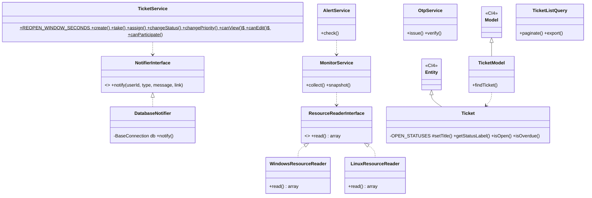

# A06 — Pemrograman berorientasi objek (Unit 6, J.620100.018.02)

Kode produksi dan demonstrasi terpisah: logika aplikasi di `app/`, demonstrasi konsep di `oop-demo/demo.php`.

## Diagram kelas (ringkas)



## Pemetaan elemen kompetensi

| Elemen | Bukti pada kode |
|---|---|
| 1.1 Class | `TicketService`, `AlertService`, `OtpService`, `MonitorService`, `TicketListQuery`, entity `Ticket`, model `TicketModel` |
| 1.2 Properti class direalisasikan sebagai prosedur/fungsi | `App\Entities\Ticket`: setter `setTitle()` (merapikan spasi), getter `getStatusLabel()`, `isOpen()`, `slaMinutesRemaining()`, `isOverdue()`; `oop-demo`: `getNama()`/`setNama()` |
| 1.3 Data di dalam class secara mandiri | `TicketService::REOPEN_WINDOW_SECONDS`, `AlertService::REMINDER_INTERVAL_SECONDS`, `Ticket::OPEN_STATUSES` (private const), properti `$notifier`/`$activity` |
| 1.4 Hak akses | `private` (`Ticket::OPEN_STATUSES`, `PengirimDasar::$nama`), `protected` (`PengirimDasar::$prefix`, `Ticket::setTitle()`), `public` (API layanan). Uji: `TicketEntityTest` memverifikasi perilaku publik |
| 2.1–2.3 Tipe data dan kontrol | Parameter/return bertipe (`int`, `string`, `?array`), `declare(strict_types=1)` di `oop-demo`, percabangan/perulangan di metode layanan |
| 3.1 Inheritance | `Ticket extends Entity`, `TicketModel extends Model`; `PengirimDatabase`/`PengirimDemo extends PengirimDasar` di `oop-demo` |
| 3.2 Polymorphism | `NotifierInterface` dipakai `DatabaseNotifier` (aplikasi) serta `PengirimDatabase`/`PengirimDemo` (`oop-demo`, fungsi `tampilkan(Pengirim $p)`); `ResourceReaderInterface` memiliki dua implementasi produksi (Windows/Linux) dan implementasi anonim pada uji `AlertServiceTest` |
| 3.3 Overloading | PHP **tidak** mendukung overloading metode menurut tanda tangan. `oop-demo/demo.php` mensimulasikannya dengan `__call()` (`format(1 argumen)` vs `format(2 argumen)`) dan menjelaskan keterbatasan: dispatch dilakukan manual berdasarkan `count($arguments)`, tanpa pemeriksaan tipe oleh bahasa |
| 4.1 Interface | `NotifierInterface`, `ResourceReaderInterface`, `Pengirim` |
| 4.2 Paket (namespace) | `App\Services`, `App\Libraries\Notifier`, `App\Libraries\Resource`, `App\Entities`, `App\Models`, `App\Filters`, `OopDemo` |
| 5.1–5.2 Kompilasi dan bebas salah sintaks | `php -l` seluruh berkas (hasil `util/hasil-php-l.txt` memuat `oop-demo/demo.php`); PHPStan level 5 tanpa error pada `app/` |

## Hasil eksekusi `php oop-demo/demo.php`

```
Info untuk Ani: Tiket diterima
[DEMO] Budi: Tiket diterima
Tiket
Status: Selesai
```

## Bukti pengujian OOP

`tests/unit/TicketEntityTest.php` (setter merapikan judul; `isOverdue()` hanya untuk tiket terbuka), `tests/unit/AlertServiceTest.php` (implementasi `ResourceReaderInterface` anonim disuntikkan sebagai polimorfisme), `tests/unit/TicketServiceTest.php::testCanEditPolicy`.
