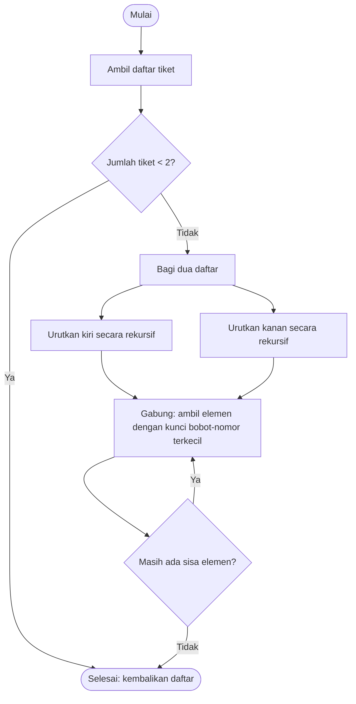
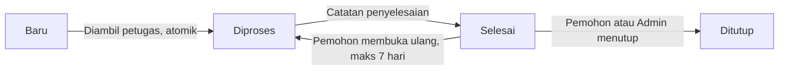

# A09 — Algoritma pemrograman (Unit 9, J.620100.022.02)

Kode: `algoritma/algorithms.php` (insertion sort, merge sort, pencarian linear/biner pada bilangan), `algoritma/tiket.php` (bubble sort, urut tiket per prioritas, pencarian nomor tiket), `algoritma/benchmark.php`. Uji: `tests/unit/AlgorithmsTest.php`. Hasil ukur: `docs/A09-benchmark.csv`.

## 1. Tipe data, variabel, konstanta, varian/invarian (elemen 1)

| Konsep | Penjelasan pada kode |
|---|---|
| Tipe data (1.1) | `int` untuk bobot/indeks, `string` untuk nomor tiket, `array` daftar dengan anotasi `list<int>` / `list<array{ticket_no: string, priority: string}>`, `bool` untuk penanda `$swapped`. `declare(strict_types=1)` mencegah konversi diam-diam |
| Variabel (1.2) | `$low`/`$high`/`$mid` (batas pencarian biner), `$i`/`$j` (penunjuk gabung), `$swapped` (apakah ada pertukaran), `$k` (putaran luar bubble sort) — masing-masing dideklarasikan dekat pemakaian dan berlingkup fungsi |
| Konstanta (1.3) | `BOBOT_PRIORITAS = ['Kritis' => 0, 'Tinggi' => 1, 'Sedang' => 2, 'Rendah' => 3]` (kunci urut prioritas, tidak boleh berubah saat urut berjalan) |
| Invarian | Insertion: sebelum iterasi `i`, indeks `0..i-1` terurut. Bubble: setelah putaran `k`, `k` elemen terbesar berada di posisi akhir. Merge: keluaran selalu terurut dan memuat elemen yang sudah diambil dari kedua bagian. Biner: bila target ada, ia ada di `[low, high]` |
| Varian | Insertion: `n - i` menurun; Bubble: batas dalam `n-1-k` menurun; Biner: `high - low + 1` menyusut tiap iterasi; Merge: ukuran bagian berkurang setengah tiap rekursi — semuanya menjamin berhenti |

## 2. Alur logika (elemen 2)

Metode (2.1): pengurutan tiket per prioritas memakai merge sort karena stabil dan `O(n log n)`; pencarian nomor tiket memakai linear (data belum terurut) dan biner (sudah terurut). Komponen (2.2): fungsi `urutkanTiketPerPrioritas`, `kunciTiket`, `cariNomorLinear`, `cariNomorBiner`, konstanta `BOBOT_PRIORITAS`. Relasi (2.3): `urutkanTiketPerPrioritas` → `kunciTiket` (membuat kunci gabungan `bobot|nomor`); `cariNomorBiner` mensyaratkan keluaran urut menurut `ticket_no`. Alur (2.4) dari mulai sampai selesai:



Alur status tiket (state machine, juga dipakai `TicketService::changeStatus`):



Pseudocode pencarian biner nomor tiket:

```
FUNGSI cariNomorBiner(daftarTerurut, nomor)
    low <- 0 ; high <- panjang(daftarTerurut) - 1
    SELAMA low <= high
        mid <- (low + high) DIV 2
        bandingkan <- strcmp(daftarTerurut[mid].nomor, nomor)
        JIKA bandingkan = 0 MAKA KEMBALIKAN mid
        JIKA bandingkan < 0 MAKA low <- mid + 1
        SELAIN ITU high <- mid - 1
    KEMBALIKAN -1
```

## 3. Sorting dan searching (elemen 3) dan prosedur/fungsi (elemen 4)

Sorting (3.1): `bubbleSort`, `insertionSort`, `mergeSort`, `urutkanTiketPerPrioritas`. Searching (3.2): `linearSearch`, `binarySearch`, `cariNomorLinear`, `cariNomorBiner`. Penggunaan kembali fungsi (4.1–4.3): `urutkanTiketPerPrioritas` memanggil dirinya (rekursi) dan `kunciTiket`; `benchmark.php` memanggil fungsi yang sama untuk setiap ukuran n lewat fungsi pembungkus `ukur()` (fungsi yang menerima fungsi). Prosedur (4.2): `echo` hasil di `benchmark.php`. Fungsi (4.3): seluruh fungsi di atas mengembalikan nilai.

## 4. Kompleksitas dan hasil ukur (elemen 5)

| Algoritma | Waktu (terburuk) | Memori tambahan | Catatan |
|---|---|---|---|
| bubbleSort | O(n²), terbaik O(n) | O(1) | Berhenti dini bila tak ada pertukaran |
| insertionSort | O(n²), terbaik O(n) | O(1) | Cepat untuk data hampir terurut |
| mergeSort / urutkanTiketPerPrioritas | O(n log n) | O(n) | Stabil |
| linearSearch / cariNomorLinear | O(n) | O(1) | Tak butuh data terurut |
| binarySearch / cariNomorBiner | O(log n) | O(1) | Butuh data terurut |

Hasil `php algoritma/benchmark.php` (PHP 8.2.12, Windows 11, i5-11400H; waktu = median 3 pengulangan; memori = puncak tambahan `memory_get_peak_usage`; pencarian diukur 1.000 panggilan lalu dibagi 1.000):

| n | bubbleSort ms | insertionSort ms | mergeSort ms | urutTiketPerPrioritas ms | cariLinear ms | cariBiner ms |
|---:|---:|---:|---:|---:|---:|---:|
| 100 | 0,340 | 0,107 | 0,075 | 0,258 | 0,00195 | 0,00072 |
| 1.000 | 33,642 | 8,651 | 0,881 | 3,448 | 0,01975 | 0,00107 |
| 10.000 | 3.951,851 | 960,580 | 12,932 | 57,841 | 0,50605 | 0,00137 |

| n | Memori bubble KB | insertion KB | merge KB | urutTiket KB |
|---:|---:|---:|---:|---:|
| 100 | 2,8 | 2,8 | 7,9 | 7,9 |
| 1.000 | 20,3 | 20,3 | 64,5 | 64,5 |
| 10.000 | 260,3 | 260,3 | 784,4 | 784,4 |

Analisis: dari n = 1.000 ke 10.000 (10×), bubble sort naik ±117× dan insertion sort ±111× (sesuai O(n²), ±100×), merge sort ±14,7× (sesuai O(n log n), ±13×). Pencarian linear naik ±26× sedangkan biner hanya ±1,3×. Memori bubble/insertion hanya salinan array masukan (kunci array PHP bernilai-salin), sedangkan merge sort ±3× lebih besar karena membuat potongan array pada setiap rekursi — sejalan dengan O(n) memori tambahan. Pada 10.000 data pengurutan tiket per prioritas (57,8 ms) jauh lebih cepat daripada bubble sort (3,95 detik); produksi memakai `ORDER BY` di SQL, algoritma ini hanya bukti Unit 9.

Seluruh algoritma diverifikasi hasilnya (`benchmark.php` melempar `RuntimeException` bila urutan atau indeks salah) dan `tests/unit/AlgorithmsTest.php`.
